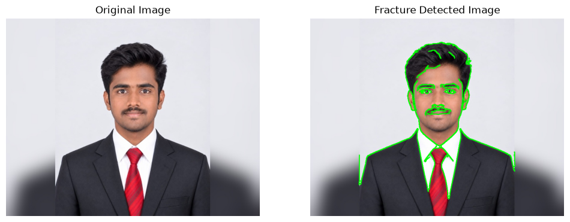

# Workshop 4 – Coin Detection using OpenCV in Python

## Name : MUTHUAKASH M

## Register Number : 212225230194

## Aim

To detect objects in an image using OpenCV by applying image preprocessing techniques such as grayscale conversion, Gaussian Blur, erosion, dilation, Canny edge detection, and contour detection.

## Software Requirements

- Python
- Jupyter Notebook
- OpenCV
- NumPy
- Matplotlib

## Algorithm

1. Import the required libraries OpenCV, NumPy, and Matplotlib.
2. Read the input image using `cv2.imread()`.
3. Convert the original image into a grayscale image.
4. Apply Gaussian Blur to reduce noise.
5. Create a 5×5 kernel using NumPy.
6. Apply erosion followed by dilation to process the image.
7. Apply Canny Edge Detection to identify object edges.
8. Find contours using `cv2.findContours()`.
9. Draw the detected contours on the original image.
10. Display the original image and detected result.

## Program 1: Import Libraries

```python
import cv2
import numpy as np
import matplotlib.pyplot as plt
```

## Program 2: Image Preprocessing

```python
def preprocess_image(image):
    gray = cv2.cvtColor(image, cv2.COLOR_BGR2GRAY)
    blurred = cv2.GaussianBlur(gray, (5, 5), 0)
    return blurred
```

## Program 3: Detect Objects using Contours

```python
def detect_fractures(preprocessed, original):
    kernel = np.ones((5, 5), np.uint8)

    erosion = cv2.erode(preprocessed, kernel, iterations=1)
    dilation = cv2.dilate(erosion, kernel, iterations=1)

    edges = cv2.Canny(dilation, 50, 150)

    contours, _ = cv2.findContours(
        edges.copy(),
        cv2.RETR_EXTERNAL,
        cv2.CHAIN_APPROX_SIMPLE
    )

    result = original.copy()
    cv2.drawContours(result, contours, -1, (0, 255, 0), 2)

    return result
```

## Program 4: Display the Results

```python
def present_results(original_image, processed_image):

    original_rgb = cv2.cvtColor(
        original_image, cv2.COLOR_BGR2RGB
    )

    processed_rgb = cv2.cvtColor(
        processed_image, cv2.COLOR_BGR2RGB
    )

    plt.figure(figsize=(12, 6))

    plt.subplot(1, 2, 1)
    plt.title("Original Image")
    plt.imshow(original_rgb)
    plt.axis('off')

    plt.subplot(1, 2, 2)
    plt.title("Fracture Detected Image")
    plt.imshow(processed_rgb)
    plt.axis('off')

    plt.show()
```

## Program 5: Main Execution

```python
image_path = 'Qno. 1.jpg'
image = cv2.imread(image_path)

if image is None:
    print("Error: Image not found. Check the file path.")
else:
    preprocessed = preprocess_image(image)

    fracture_detected_image = detect_fractures(
        preprocessed, image
    )

    present_results(image, fracture_detected_image)
```

## Output



## Result

Thus, image preprocessing, morphological operations, Canny edge detection, and contour detection were successfully implemented using OpenCV in Python to identify object boundaries in the input image.